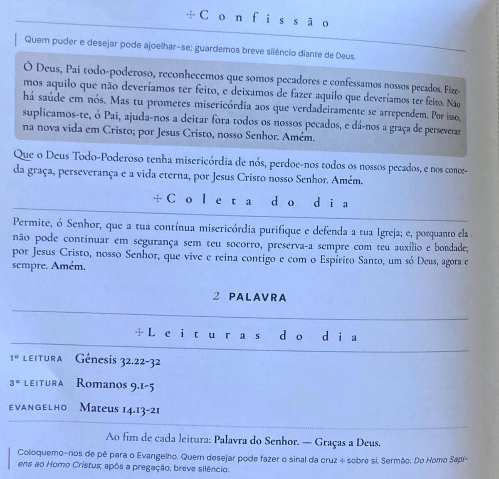

Quem visita a Anglicana Rio pela primeira vez percebe que, no culto, todos respondem juntos, confessam juntos e dizem o Credo juntos. E logo vem a pergunta: **por que orar com palavras prontas?**

A resposta está numa frase antiga da Igreja: ***lex orandi, lex credendi***. Em português: **"a forma como oramos mostra aquilo em que cremos"**.

## Uma ideia antiga

No século V, um cristão chamado Próspero da Aquitânia quis mostrar que a fé é um presente de Deus. Ele fez isso apontando para as orações da Igreja, que pedia todos os domingos a Deus pela conversão das pessoas. A lógica era simples: se pedimos a Deus que dê fé às pessoas, é porque cremos que a fé vem dele. Assim, a oração já ensinava a fé.

## Liturgia é o povo em ação

*Liturgia* quer dizer "serviço do povo". O culto não é um show para uma plateia. É a Igreja inteira respondendo ao Deus que nos chama. Ninguém só assiste: todos participam.

Os anglicanos guardam a sua fé principalmente num livro de oração, o *Livro de Oração Comum* (1549). Por isso se diz: **para saber em que um anglicano crê, observe como ele ora.**

## O que nossas orações ensinam

<figure class="blog-figure">
  
  <figcaption>Confissão, Coleta do dia e leituras no folheto do culto de 2 de agosto de 2026.</figcaption>
</figure>

- **Coleta pela Pureza.** Logo no início, pedimos: *"purifica os pensamentos de nossos corações pela inspiração do teu Santo Espírito"*. Essa oração ensina que Deus conhece o nosso coração e que só o seu Espírito pode nos purificar.
- **Confissão.** Confessamos juntos porque cremos que todos precisamos do perdão e que Deus perdoa de verdade.
- **Credo.** Repetimos a mesma fé dos cristãos de todos os tempos. Não inventamos uma fé nova a cada domingo.
- **Eucaristia.** Pedimos que Deus *"envie o seu Espírito Santo sobre nós e sobre estes dons"*. O pedido mostra que quem age na Eucaristia é Deus, e não o ministro.
- **Despedida.** Saímos dizendo *"sirvamos ao Senhor com alegria"*. O culto continua na nossa vida durante a semana.

## E a repetição?

Aprendemos a orar como aprendemos a falar: repetindo, até que as palavras se tornem nossas. Nos dias difíceis, quando faltam palavras, as orações da Igreja nos sustentam.

Jesus disse que Deus procura quem o adore *"em espírito e em verdade"* (João 4.23-24). A liturgia não prende o coração. Ela dá forma à nossa adoração.
